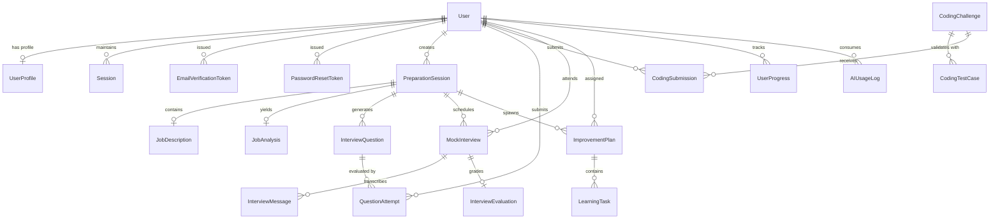

# InterviewAI – Complete Database Architecture & Specifications

This document outlines the database architecture, schema definitions, entity relationships, indexing strategies, referential integrity policies, and seeding workflows for **InterviewAI** (Phase 4: Complete Database Implementation).

---

## 1. Architectural Overview & Design Principles

The database architecture is designed with the following core principles:
1. **Third Normal Form (3NF) & Strategic Denormalization**: Core transactional and relational entities are strictly normalized to prevent anomalies. High-cardinality AI payloads, evaluation rubrics, test constraints, and parsed competencies utilize PostgreSQL `JSONB` for schema flexibility and efficient JSON path operations.
2. **User Data Isolation & Ownership**: All tenant data is linked directly or through preparation sessions to `userId`. Composite indexes on `[userId, ...]` guarantee sub-millisecond query performance and prevent horizontal privilege escalation.
3. **Additive & Non-Destructive Migrations**: Production migrations are structured with safe `IF NOT EXISTS` constructs, non-destructive column additions, and explicit PostgreSQL domain enums.
4. **Referential Integrity & Cascading Rules**: Dependent records (e.g., job descriptions, questions, submissions, test cases) automatically cascade on deletion of their parent entity (`onDelete: Cascade`), while audit logs and AI usage telemetry retain references (`onDelete: SetNull`) to prevent orphaned analytics or data loss.
5. **Deterministic & Idempotent Seeding**: Seeding utilizes Prisma's `upsert` semantics to allow safe execution in development, CI/CD, and staging environments without duplicate key collisions.

---

## 2. Entity-Relationship Overview



---

## 3. Database Modules & Schema Details

The database is partitioned into 7 cohesive modules containing **20 models** and **15 domain enums**.

### Module A: User & Authentication
- **`User`**: Core account identity (`id`, `name`, `email`, `password`, `isEmailVerified`, `isActive`, timestamps).
- **`UserProfile`**: Candidate profile dossier (`fullName`, `headline`, `bio`, `currentRole`, `experience`, `skills` JSONB, `preferredJobRole`).
- **`Session`**: Refresh token session management with user agent tracking, SHA-256 hashed refresh tokens, and revocation timestamps.
- **`EmailVerificationToken`**: Single-use tokens for email confirmation.
- **`PasswordResetToken`**: Time-limited single-use tokens for password recovery.

### Module B: Job Preparation
- **`PreparationSession`**: High-level interview preparation workspace (`targetRole`, `companyName`, `industry`, `experienceLevel`, `status`, `progress`).
  - *Indexes*: `[userId, status]`, `[userId, createdAt]`.
- **`JobDescription`**: Raw and parsed job posting details (`rawText`, `sourceUrl`, `responsibilities` JSONB, `requirements` JSONB, `extractedSkills` JSONB).
- **`JobAnalysis`**: AI-extracted skills matrix, required vs preferred qualifications, difficulty assessment, and matched candidate skills.

### Module C: Interview Questions & Practice
- **`InterviewQuestion`**: Curated and AI-synthesized interview prompts (`category`, `difficulty`, `question`, `idealAnswerOutline`, `keyPoints` JSONB, `rubric` JSONB).
  - *Indexes*: `[preparationSessionId, category]`, `[category, difficulty]`.
- **`QuestionAttempt`**: Candidate answers with AI evaluation (`answerText`, `audioUrl`, `durationSeconds`, `score`, `feedback`, `strengths` JSONB, `improvements` JSONB, `status`).
  - *Indexes*: `[userId, questionId]`, `[userId, status]`.

### Module D: Coding Assessment & Arena
- **`CodingChallenge`**: Algorithmic problem bank (`title`, `slug`, `difficulty`, `category`, `description`, `starterCode` JSONB, `solutionTemplates` JSONB, `hints` JSONB, `timeLimitMs`, `memoryLimitMb`).
  - *Unique Index*: `[slug]`.
- **`CodingTestCase`**: Automated validation suites (`input`, `expectedOutput`, `isHidden`, `explanation`, `orderIndex`).
  - *Index*: `[challengeId, isHidden]`.
- **`CodingSubmission`**: Code submissions and sandbox execution telemetry (`language`, `sourceCode`, `status`, `runtimeMs`, `memoryKb`, `passedTests`, `totalTests`, `testResults` JSONB, `codeReview` JSONB).
  - *Indexes*: `[userId, challengeId]`, `[userId, status]`.

### Module E: Mock Interview Simulation
- **`MockInterview`**: Complete end-to-end simulated interview (`interviewType`, `status`, `startedAt`, `endedAt`, `durationSeconds`, `recordingUrl`, `overallScore`, `feedbackSummary`).
  - *Indexes*: `[userId, status]`, `[userId, startedAt]`.
- **`InterviewMessage`**: Real-time transcript with turn-by-turn sentiment and timing (`role`, `messageType`, `content`, `audioUrl`, `sequenceNumber`, `speechMetrics` JSONB).
  - *Unique Index*: `[mockInterviewId, sequenceNumber]`.
- **`InterviewEvaluation`**: Multi-dimensional grading report (`technicalScore`, `communicationScore`, `problemSolvingScore`, `culturalFitScore`, `detailedFeedback` JSONB, `actionableRecommendations` JSONB).

### Module F: Learning, Improvement & Mastery
- **`ImprovementPlan`**: Personalized post-interview learning roadmaps (`title`, `targetDate`, `status`, `focusAreas` JSONB, `milestones` JSONB).
  - *Indexes*: `[userId, status]`.
- **`LearningTask`**: Discrete actionable learning units (`title`, `description`, `resourceType`, `resourceUrl`, `priority`, `estimatedMinutes`, `status`, `dueDate`).
  - *Indexes*: `[planId, status]`, `[planId, priority]`.
- **`UserProgress`**: Granular candidate skill mastery matrix (`category`, `skillName`, `currentLevel`, `targetLevel`, `assessmentCount`, `lastAssessedAt`).
  - *Unique Index*: `[userId, category, skillName]`.

### Module G: AI Telemetry & Usage Tracking
- **`AIUsageLog`**: Comprehensive audit trail for AI API invocations (`provider`, `model`, `operation`, `promptTokens`, `completionTokens`, `totalTokens`, `durationMs`, `costUsd`, `status`, `errorMessage`).
  - *Indexes*: `[userId, operation]`, `[userId, createdAt]`, `[provider, model]`.

---

## 4. Domain Enums (15 Total)

| Enum Name | Defined Values |
| :--- | :--- |
| `PreparationStatus` | `DRAFT`, `ANALYZING`, `ACTIVE`, `COMPLETED`, `ARCHIVED` |
| `ExperienceLevel` | `ENTRY_LEVEL`, `JUNIOR`, `MID_LEVEL`, `SENIOR`, `LEAD`, `EXECUTIVE` |
| `InterviewCategory` | `TECHNICAL`, `BEHAVIORAL`, `SYSTEM_DESIGN`, `CODING`, `HR`, `LEADERSHIP` |
| `DifficultyLevel` | `EASY`, `MEDIUM`, `HARD`, `EXPERT` |
| `QuestionAttemptStatus` | `NOT_ATTEMPTED`, `IN_PROGRESS`, `EVALUATED`, `SKIPPED` |
| `CodingExecutionStatus` | `PENDING`, `RUNNING`, `ACCEPTED`, `WRONG_ANSWER`, `TIME_LIMIT_EXCEEDED`, `MEMORY_LIMIT_EXCEEDED`, `COMPILATION_ERROR`, `RUNTIME_ERROR` |
| `InterviewType` | `FULL_MOCK`, `TECHNICAL_ONLY`, `BEHAVIORAL_ONLY`, `SYSTEM_DESIGN_ONLY`, `QUICK_FIRE` |
| `MockInterviewStatus` | `SCHEDULED`, `IN_PROGRESS`, `ANALYZING`, `COMPLETED`, `CANCELLED` |
| `MessageRole` | `CANDIDATE`, `AI_INTERVIEWER`, `SYSTEM` |
| `MessageType` | `TEXT`, `AUDIO_TRANSCRIPT`, `CODE_SNIPPET`, `SYSTEM_PROMPT` |
| `ImprovementPlanStatus` | `ACTIVE`, `PAUSED`, `COMPLETED`, `ABANDONED` |
| `LearningTaskStatus` | `TODO`, `IN_PROGRESS`, `COMPLETED`, `SKIPPED` |
| `TaskPriority` | `LOW`, `MEDIUM`, `HIGH`, `URGENT` |
| `AIUsageOperation` | `JD_ANALYSIS`, `QUESTION_GENERATION`, `ANSWER_EVALUATION`, `CODE_REVIEW`, `LIVE_INTERVIEW_TURN`, `MOCK_EVALUATION`, `PLAN_GENERATION` |
| `AIUsageStatus` | `SUCCESS`, `FAILED`, `RATE_LIMITED`, `TIMEOUT` |

---

## 5. Indexes and Performance Strategy

To ensure scalable performance across millions of rows, composite B-Tree indexes have been configured to support frequent query patterns:

1. **Candidate Query Isolation & Multi-tenant Performance**:
   - `[userId, status]` on `PreparationSession`, `MockInterview`, and `ImprovementPlan`: enables ultra-fast dashboard and workspace lookups scoped to the authenticated user.
   - `[userId, questionId]` on `QuestionAttempt`: accelerates lookups of previous attempts by question.
   - `[userId, challengeId]` on `CodingSubmission`: optimizes retrieval of user submissions per problem.
   - `[userId, createdAt]` on `PreparationSession` and `AIUsageLog`: supports cursor/offset pagination without sequential table scans.
2. **Category, Practice & Security Filtering**:
   - `[preparationSessionId, category]` and `[category, difficulty]` on `InterviewQuestion`: optimizes question generation and category-specific drilling.
   - `[challengeId, isHidden]` on `CodingTestCase`: allows public sample test case delivery during coding while strictly hiding evaluation tests.
3. **Sequence & Data Integrity**:
   - `@@unique([mockInterviewId, sequenceNumber])` on `InterviewMessage`: enforces strict chronological order and prevents race-condition duplicates during real-time speech transcription.
   - `@@unique([userId, category, skillName])` on `UserProgress`: enables upsert-based continuous tracking of candidate competency growth.
   - `@@unique([mockInterviewId])` on `InterviewEvaluation`: ensures 1:1 evaluation reports per interview.

---

## 6. Migration and Seeding

### Additive Migration
The Phase 4 additive migration script is located at:
`backend/prisma/migrations/20261102_phase4_complete_database/migration.sql`

Key features of this migration:
- **Zero data loss**: Safe `IF NOT EXISTS` checks on all types, tables, and indexes.
- **Check constraints**:
  - `CHECK (progress >= 0 AND progress <= 100)`
  - `CHECK (score >= 0 AND score <= 100)`
  - `CHECK (prompt_tokens >= 0 AND completion_tokens >= 0)`
  - `CHECK (duration_seconds >= 0)`

### Idempotent Seeding
The seed script (`backend/prisma/seed.js`) populates the database with:
- **Verified Candidate**: Demo account (`demo@interviewai.dev`) with full profile.
- **Preparation Sessions**: Senior Full-Stack Engineer and Distributed Systems Architect sessions.
- **Curated Questions**: Technical (Node.js Event Loop, PostgreSQL B-Tree Indexing, React Hooks), Behavioral (STAR conflict resolution), and System Design (Distributed Rate Limiter).
- **Coding Challenges & Test Cases**: Two Sum, Valid Parentheses, Maximum Subarray, and Binary Search with full public and hidden test fixtures.
- **Improvement Plan & Tasks**: Actionable learning roadmap with prioritized tasks.
- **Skill Progress Records**: Granular ratings for JavaScript, PostgreSQL, System Design, and Behavioral Interviewing.

Execute seeding:
```powershell
npm run db:seed
```

---

## 7. Database Service Layer & Zod Validation

- **`backend/src/services/db.service.js`**: Provides abstracted, secure database utilities:
  - `getPaginationParams(query)` / `formatPaginatedResponse(items, total, page, limit)`: Centralized pagination with max limits.
  - `verifyOwnership(prisma, model, resourceId, userId)`: Prevents Insecure Direct Object References (IDOR).
  - `withTransaction(prisma, operations)`: Transaction boundary helper.
  - `getUserDashboardStats(userId)`: Aggregates real-time candidate statistics across sessions, interviews, questions, and challenges.
- **`backend/src/validators/database.validator.js`**: Enforces runtime data integrity via Zod schemas for preparation sessions, question attempts, code submissions, mock interview setup, and AI telemetry logging.
