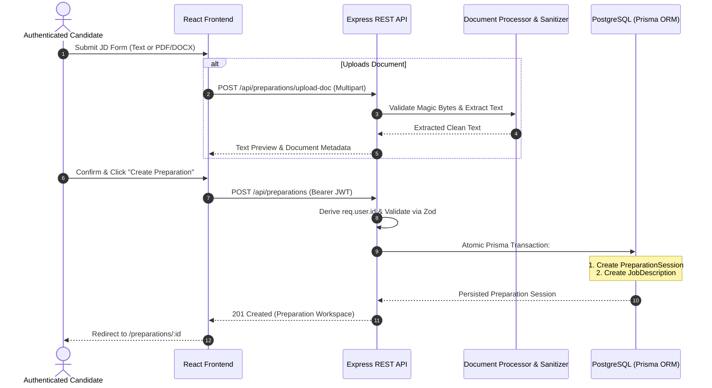

# InterviewAI – Job Preparation Management Module (Phase 5)

## 1. Architectural Overview & Workflow

The Job Preparation Management Module empowers authenticated candidates to create, manage, and track tailored interview preparation tracks based on real-world Job Descriptions (JDs). It bridges the candidate's target job posting with AI interview simulations, question pools, and coding arenas.



---

## 2. Core Capabilities

1. **Job Description Ingestion**:
   - Direct text entry with real-time character count.
   - Document upload supporting PDF (`%PDF-`), DOCX (`word/document.xml`), TXT, and Markdown.
   - Zero-dependency streaming multipart parser enforcing strict 5MB upload limits.
   - Executable rejection (blocks PE `.exe`, ELF, Mach-O).
   - Server-side UUID filename generation in isolated `uploads/` directory with path traversal protection.
2. **Preference & Difficulty Tuning**:
   - Experience levels: `ENTRY`, `JUNIOR`, `MID`, `SENIOR`, `LEAD`, `EXECUTIVE`.
   - Programming languages: `JavaScript`, `TypeScript`, `Python`, `Java`, `Go`, `C++`, `C#`, `SQL`.
   - Difficulty tiers: `EASY`, `MEDIUM`, `HARD`, `EXPERT`.
   - Multi-select focus areas: Technical interview, System design, Coding assessment, HR & STAR behavioral, Scenario-based, Company-specific.
3. **Multi-Tenant Ownership & Security**:
   - Every preparation session is partitioned by `userId: req.user.id`.
   - Cross-user access returns `403 Forbidden` or `404 Not Found`. User A cannot read, modify, or archive User B's sessions or job descriptions.
4. **Soft Deletion & Restoration**:
   - Archiving marks `status: 'ARCHIVED'` and populates `deletedAt` without cascading data loss.
   - Restoring re-activates the workspace with `deletedAt: null`.
5. **Real Dashboard Integration**:
   - `/api/preparations/stats` delivers real aggregate counts (total, active, completed, archived, average readiness progress) to `/dashboard`.

---

## 3. Database Schema Updates

### `PreparationSession` Model
```prisma
model PreparationSession {
  id                String             @id @default(uuid())
  userId            String
  title             String
  companyName       String
  jobTitle          String
  location          String?
  experienceLevel   ExperienceLevel    @default(MID)
  yearsOfExperience Int?
  preferredLanguage String             @default("JavaScript")
  difficulty        DifficultyLevel    @default(MEDIUM)
  status            PreparationStatus  @default(DRAFT)
  progress          Int                @default(0) // 0-100
  preferences       Json               @default("[]")
  createdAt         DateTime           @default(now())
  updatedAt         DateTime           @updatedAt
  deletedAt         DateTime?

  user              User               @relation(fields: [userId], references: [id], onDelete: Cascade)
  jobDescription    JobDescription?
  jobAnalysis       JobAnalysis?
  questions         InterviewQuestion[]
  codingChallenges  CodingChallenge[]
  mockInterviews    MockInterview[]
  improvementPlans  ImprovementPlan[]
  aiUsageLogs       AIUsageLog[]

  @@index([userId])
  @@index([status])
  @@index([createdAt])
  @@index([userId, status])
  @@index([userId, createdAt])
  @@map("preparation_sessions")
}
```

### `JobDescription` Model
```prisma
model JobDescription {
  id                   String             @id @default(uuid())
  preparationSessionId String             @unique
  rawText              String             @db.Text
  sourceType           String             @default("PASTED_TEXT")
  originalFileName     String?
  fileSize             Int?
  createdAt            DateTime           @default(now())
  updatedAt            DateTime           @updatedAt

  preparationSession   PreparationSession @relation(fields: [preparationSessionId], references: [id], onDelete: Cascade)

  @@map("job_descriptions")
}
```

---

## 4. API Endpoints

All endpoints require JWT Bearer authentication (`requireAuth`):

| Method | Endpoint | Description |
| :--- | :--- | :--- |
| `POST` | `/api/preparations` | Create preparation session and job description |
| `POST` | `/api/preparations/upload-doc` | Upload and parse document (PDF / DOCX / TXT) |
| `GET` | `/api/preparations` | List candidate preparations (search, filters, pagination) |
| `GET` | `/api/preparations/:id` | View preparation workspace details |
| `PATCH` | `/api/preparations/:id` | Update preparation metadata |
| `DELETE` | `/api/preparations/:id` | Soft delete / archive preparation session |
| `PATCH` | `/api/preparations/:id/restore` | Restore archived preparation session |
| `DELETE` | `/api/preparations/:id/permanent` | Permanently delete preparation session |
| `GET` | `/api/preparations/stats` | Real candidate preparation statistics |
| `GET` | `/api/preparations/:id/description` | View full job description text |
| `PATCH` | `/api/preparations/:id/description` | Update job description text |

### Sample Request: Create Preparation
```http
POST /api/preparations
Content-Type: application/json
Authorization: Bearer <JWT_ACCESS_TOKEN>

{
  "jobTitle": "Senior Full Stack Engineer",
  "companyName": "TechCorp Labs",
  "location": "San Francisco, CA (Remote)",
  "experienceLevel": "SENIOR",
  "yearsOfExperience": 6,
  "preferredLanguage": "TypeScript",
  "difficulty": "HARD",
  "preferences": [
    "Technical interview",
    "System design",
    "Coding assessment"
  ],
  "jobDescription": "We are seeking a Senior Full Stack Engineer experienced with React 18, Node.js concurrency, and PostgreSQL indexing..."
}
```

### Sample Response:
```json
{
  "success": true,
  "message": "Preparation session created successfully",
  "data": {
    "id": "123e4567-e89b-12d3-a456-426614174000",
    "title": "Senior Full Stack Engineer at TechCorp Labs",
    "companyName": "TechCorp Labs",
    "jobTitle": "Senior Full Stack Engineer",
    "status": "READY",
    "progress": 0,
    "createdAt": "2026-11-02T16:30:00.000Z"
  }
}
```

---

## 5. Automated Testing

Run the Phase 5 test suite:
```powershell
# Run backend test suite (95 tests passing)
npm run test:backend

# Run frontend architecture test suite (6 tests passing)
npm run test:frontend

# Build optimized production bundle
npm run build
```

