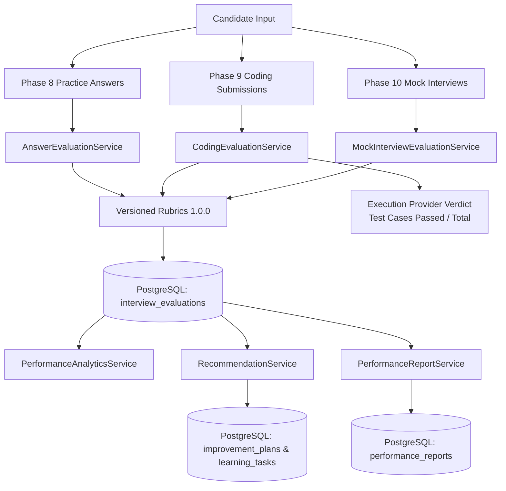

# Phase 11: AI Evaluation, Answer Analysis & Performance Reporting Engine

## 1. Executive Summary

Phase 11 introduces a comprehensive, multi-dimensional AI evaluation and performance analytics engine to InterviewAI. The system objectively analyzes individual practice answers from Phase 8, assesses coding submissions from Phase 9, evaluates complete mock interview transcripts from Phase 10, calculates scores using transparent versioned rubrics, extracts recurring candidate strengths and weaknesses, generates personalized recommendations linked to the user's improvement plan, and compiles professional performance reports.

---

## 2. Core Architecture & Design Principles



### Key Architectural Invariants
1. **Grounding in Real Execution**: In coding assessments, functional correctness (40% weight) is strictly governed by the sandbox execution provider's actual test case results (`testCasesPassed / totalTestCases`). The AI evaluator cannot override execution verdicts.
2. **Hidden Test Case Protection**: Inputs and expected outputs of hidden test cases are never leaked in feedback or prompts.
3. **Draft Safety**: Unsubmitted practice drafts are rejected with `400 Bad Request` until explicitly submitted.
4. **Mock Interview Completion Guard**: Only concluded mock interviews (`status: 'COMPLETED'`) can be evaluated.
5. **Multi-Tenant Isolation**: Cryptographic user ownership verification on all evaluations, submissions, interviews, recommendations, and reports (`403 Forbidden` on unauthorized access).

---

## 3. Versioned Evaluation Rubrics (v1.0.0)

File: `backend/src/services/evaluation/rubrics.js`

### A. Technical Interview Rubric
- **Technical Accuracy** (30%): Factual correctness, algorithms, frameworks, and syntax.
- **Conceptual Understanding** (20%): Deep mental models, architectural patterns, concurrency.
- **Problem-Solving Ability** (20%): Decomposition, structured thinking, edge case reasoning.
- **Practical Application** (15%): Production realities, caching, connection pooling, deployment.
- **Communication & Explanation** (10%): Articulation, clarity, structured terminology.
- **Completeness** (5%): Comprehensive coverage without glaring omissions.
*Sum = 100%*

### B. HR & Behavioral Rubric
- **Relevance** (20%): Direct response without rambling or evasion.
- **Communication Clarity** (20%): Narrative arc and professional vocabulary.
- **Answer Structure (STAR)** (20%): Situation, Task, Action, and measurable Result.
- **Authenticity & Specificity** (15%): Specific personal ownership rather than vague team claims.
- **Professionalism** (15%): Constructive coworker relations, empathy, accountability.
- **Self-Awareness** (10%): Honest reflection on growth areas and lessons learned.
*Sum = 100%*

### C. System Design Rubric
- **Requirements Understanding** (15%): Scope, functional & non-functional bounds (QPS, latency, storage).
- **Architecture & Component Design** (20%): Modular decomposition, decoupled services.
- **Database & Data Modeling** (15%): SQL vs NoSQL, schema design, read/write access patterns.
- **Scalability & Performance** (15%): Horizontal scaling, sharding, caching tiers.
- **Reliability & Availability** (10%): Replication, circuit breakers, backup failover.
- **Security & Auth** (10%): Authentication, authorization, token encryption, VPC isolation.
- **Trade-off Analysis** (10%): CAP theorem, cost vs latency compromises.
- **Communication** (5%): Whiteboarding clarity, collaborative dialogue.
*Sum = 100%*

### D. Scenario-Based & Production Incident Rubric
- **Problem Understanding** (15%): Grasping blast radius, outage severity, and incident symptoms.
- **Investigation Approach** (20%): Telemetry triage, logs, metrics, distributed traces.
- **Decision-Making** (20%): Mitigation/rollback prioritization during active outage.
- **Technical Solution** (20%): Sound root-cause fix and regression prevention.
- **Stakeholder Communication** (10%): Customer broadcasts and cross-team alignment.
- **Risk Management & RCA** (15%): Blameless post-mortem and automated alert guards.
*Sum = 100%*

### E. Coding & Algorithmic Rubric
- **Functional Correctness** (40%): **Grounded in test cases passed / total test cases**.
- **Algorithmic Efficiency** (20%): Asymptotic time & space complexity relative to problem bounds.
- **Code Quality & Idioms** (15%): Idiomatic language patterns, clean naming, modular methods.
- **Edge Case Handling** (10%): Empty inputs, extremes, null safety, boundary checks.
- **Readability & Maintainability** (10%): Self-documenting logic, clean formatting.
- **Explanation** (5%): Clear complexity walkthrough and data structure justification.
*Sum = 100%*

### F. Performance Classification Scale
- **90–100**: *Excellent*
- **80–89**: *Very Good*
- **70–79**: *Good*
- **60–69**: *Average*
- **40–59**: *Needs Improvement*
- **0–39**: *Poor*

---

## 4. Database Schema Extensions

Additive migration: `backend/prisma/migrations/20261103_phase11_evaluation_engine/migration.sql`

### 1. Extended `InterviewEvaluation` Model
```prisma
model InterviewEvaluation {
  id                     String         @id @default(uuid())
  userId                 String?
  sourceType             String         @default("MOCK_INTERVIEW") // MOCK_INTERVIEW, PRACTICE_ANSWER, CODING_SUBMISSION
  sourceId               String?
  mockInterviewId        String?        @unique
  questionAttemptId      String?
  codingSubmissionId     String?
  overallScore           Int            // 0-100
  classification         String?
  rubricVersion          String         @default("1.0.0")
  evaluationStatus       String         @default("COMPLETED")
  criterionScores        Json           @default("[]")
  strengths              Json           @default("[]")
  weaknesses             Json           @default("[]")
  missingConcepts        Json           @default("[]")
  recommendations        Json           @default("[]")
  improvementSuggestions Json           @default("[]")
  detailedFeedback       String?        @db.Text
  improvedAnswer         String?        @db.Text
  confidence             Float?
  limitations            Json           @default("[]")
  evaluatedAt            DateTime       @default(now())
  createdAt              DateTime       @default(now())
  updatedAt              DateTime       @updatedAt
}
```

### 2. `PerformanceReport` Model
```prisma
model PerformanceReport {
  id                   String              @id @default(uuid())
  userId               String
  preparationSessionId String?
  reportType           String              @default("COMPREHENSIVE")
  title                String
  overallScore         Int                 @default(0)
  classification       String?             @default("Good")
  categoryScores       Json                @default("{}")
  skillScores          Json                @default("{}")
  summary              String?             @db.Text
  strengths            Json                @default("[]")
  weaknesses           Json                @default("[]")
  recommendations      Json                @default("[]")
  evaluationCount      Int                 @default(0)
  metrics              Json                @default("{}")
  generatedAt          DateTime            @default(now())
  createdAt            DateTime            @default(now())
  updatedAt            DateTime            @updatedAt
}
```

### 3. `ImprovementRecommendation` Model
```prisma
model ImprovementRecommendation {
  id                String       @id @default(uuid())
  userId            String
  evaluationId      String?
  skill             String
  weakness          String       @db.Text
  whyItMatters      String?      @db.Text
  recommendedAction String       @db.Text
  practiceActivity  String?      @db.Text
  priority          TaskPriority @default(MEDIUM)
  estimatedMinutes  Int          @default(30)
  status            String       @default("PENDING") // PENDING, ACCEPTED, DISMISSED
  createdAt         DateTime     @default(now())
  updatedAt         DateTime     @updatedAt
}
```

---

## 5. REST API Specifications

### 1. Evaluations (`/api/evaluations`)
- `POST /answers/:attemptId`: Evaluates a Phase 8 submitted answer attempt.
- `GET /answers/:attemptId`: Retrieves evaluation for a question attempt.
- `POST /coding/:submissionId`: Evaluates a Phase 9 coding submission.
- `GET /coding/:submissionId`: Retrieves evaluation for a coding submission.
- `POST /interviews/:interviewId`: Evaluates a completed Phase 10 mock interview.
- `GET /interviews/:interviewId`: Retrieves evaluation for a mock interview.
- `GET /`: Lists user's evaluations with pagination and filters.
- `GET /:evaluationId`: Retrieves evaluation by ID.
- `POST /:evaluationId/regenerate`: Re-evaluates target attempt or interview.

### 2. Performance Analytics (`/api/performance`)
- `GET /overview`: Overall summary KPIs (total evaluations, averages, coding success rate).
- `GET /categories`: Category-wise breakdown (Technical, HR, Coding, System Design, Scenario).
- `GET /trends`: Chronological performance trends.
- `GET /strengths`: Recurring candidate strengths with evidence.
- `GET /weaknesses`: Recurring candidate weaknesses with evidence.

### 3. Reports (`/api/reports`)
- `POST /generate`: Generates an official performance report archive.
- `GET /`: Lists user's generated reports.
- `GET /:reportId`: Retrieves report details.
- `GET /:reportId/download`: Provides printable export data payload.

### 4. Recommendations (`/api/improvement-recommendations`)
- `GET /`: Lists pending or historical recommendations.
- `POST /:id/accept`: Accepts recommendation and **automatically converts it into a `LearningTask` in the user's `ImprovementPlan`**!
- `POST /:id/dismiss`: Dismisses recommendation.

---

## 6. Frontend Components

1. **`Reports.jsx`** (`/reports` & `/reports/:reportId`):
   - Executive score overview card with classification badge.
   - Aggregate KPI cards (evaluated answers, mock rounds, coding success rate).
   - Category-wise competency progress bars.
   - Evidence-based strengths and weaknesses lists.
   - Historical generated reports list with modal generator and browser printing/PDF export.
2. **`EvaluationDetail.jsx`** (`/evaluations/:evaluationId`):
   - In-depth transparent scoring table showing criterion name, weights, scores, and supporting evidence quotes.
   - Assessor executive feedback narrative.
   - Missing concepts badges.
   - Exemplary model answer / alternative solution display.
   - Re-evaluate button.
3. **`ImprovementPlan.jsx`** (`/improvement-plan`):
   - Dynamic AI-identified growth recommendations cards.
   - One-click "Add to Plan" button which accepts the recommendation and generates an interactive learning task.
   - One-click "Dismiss" button.
   - Weekly milestones progress tracking bar.

---

## 7. Automated Test Results

- **Backend Test Suite**: **232 tests passing across 67 suites** (`node --test tests/**/*.test.js`).
- **Frontend Test Suite**: **20 tests passing across 1 suite** (`node --test tests/**/*.test.js`).
- **Production Bundle Build**: `vite build` completed in 1m 10s with zero errors or warnings.

